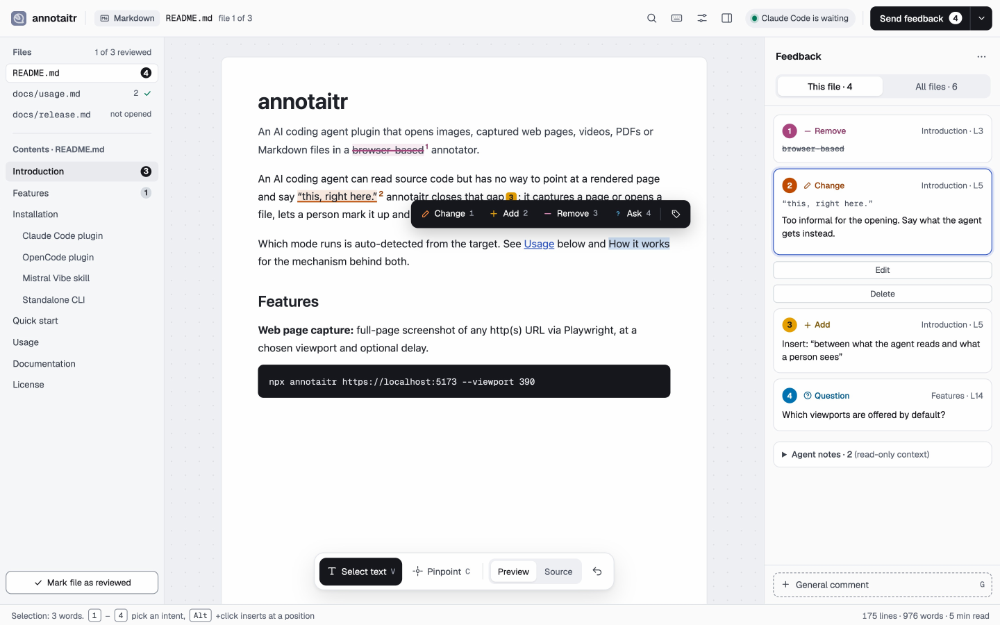

# Markdown and plain text

One or more Markdown, plain-text, config or data files open in a single review. The selection bar, the Files sidebar and the intents are described in [Tools and the feedback panel](interface.md). Shared flags and the output format are in the [CLI reference](../usage.md).

```bash
annotaitr README.md
annotaitr README.md docs/guide.md config.yaml
```



## Supported files

Markdown (`.md`, `.markdown`, `.mdown`, `.mkd`) renders as formatted text. Config and data files render as raw source with line numbers: `.yaml`, `.yml`, `.json`, `.jsonc`, `.json5`, `.toml`, `.ini`, `.cfg`, `.conf`, `.properties`, `.csv`, `.tsv`, `.log`, `.xml`, `.txt`, `.text` and `.env.example`.

Files above 2 MB are rejected. A real `.env` file is not supported, because it commonly holds secrets.

## Rounds and replies

Reopening the same set of files continues its [review session](sessions.md):
the agent answers each note with `annotaitr reply`, and the next round lists
those answers in the panel's **Replies** tab, underlines the earlier text
dashed in the preview and lets the reviewer answer back. A note whose text was
edited away is listed under "No longer in the document" with its original
quote.

When the agent revised a Markdown file since the last round, a bar above the
document reads **Changes since round N** with what changed (`+1 added · ±2
changed · −1 removed`). The button switches to a read-only view of the
document compared block by block with the version reviewed last round: added
blocks carry `+`, changed blocks `±` with the earlier version struck through
above them, and removed blocks `−` struck through where they were. A block
counts as changed when the new one has the same type and shares at least half
of its words; anything else, a moved block included, shows as removed and
added. A very long document whose middle differs throughout shows that middle
as removed and added. Notes are added in the normal view, so pressing the
button again, or **Preview**, returns to it with every note in place; undo,
redo, search, restoring a draft and opening another file return to it as
well. Plain-text files and `annotaitr changes` have no such view.

## `--feedback-notes`

Markdown mode only. Attaches read-only AI notes to the first file, for what
the agent wants to say that answers no note, such as a summary of the
changes. An answer to a note goes through `annotaitr reply` instead. A JSON array of `{text, line?}` objects, inline or as a
file path; `line` is the line number in the file being opened, omitted for a
general note.

```bash
annotaitr --feedback-notes '[{"text":"Rewrote intro","line":5}]' README.md
annotaitr --feedback-notes notes.json README.md
```

<details>
<summary>Same option via the ANNOTAITR_FEEDBACK_NOTES environment variable</summary>

```bash
ANNOTAITR_FEEDBACK_NOTES='[{"text":"Rewrote intro","line":5}]' annotaitr README.md
```

</details>

## Presenting changes before a commit

`annotaitr changes` opens changes as a walkthrough, so an agent can explain its work before it commits or opens a pull request. The diff always comes from git, the agent only supplies the text around it. Without `--base` it shows the uncommitted changes against `HEAD`, untracked files included. With `--base` it shows the whole branch against its merge base with that base, working tree included.

```bash
annotaitr changes --explain .git/annotaitr/explain.json
annotaitr changes --base main --explain explain.json
```

| Flag | Meaning |
|------|---------|
| `--base <ref>` | Show the whole branch against its merge base with this branch, tag or commit, for a review before a pull request. Default: only the uncommitted changes |
| `--explain <file>` | The agent's explanation, see below. Without it every file is shown as not explained |
| `--origin`, `--feedback-notes` | As for Markdown files |
| `--session <id>`, `--new-session` | As for every [review session](sessions.md). A session belongs to the repository, branch and comparison, so it survives new commits on the branch |

The explanation is a JSON object, every field optional:

```json
{
  "title": "Scope the facet cache per workspace",
  "summary": "Why the change was made, in a few sentences.",
  "commit": "fix: scope the facet cache per workspace",
  "files": { "src/Controller/FacetController.php": "Builds the key from page and workspace." },
  "groups": [{ "title": "Cache key", "why": "The actual fix.", "files": ["src/Controller/FacetController.php"] }],
  "focus": { "src/Controller/FacetController.php": "The key decides which data a user sees." }
}
```

`groups` is optional: chapters in reading order, each with a `title`, an optional `why` and its `files`. The file cards then appear under their group with a reviewed count, each file in the first group that names it and every other file under `Everything else`.

`focus` is optional and maps a path to the reason it needs a closer look. A file to check closely gets a flag in its card and in the file tree, a warm row with the reason under its header and a row in the overview's `Review focus` box that jumps to it. The order of the files stays the agent's. Nothing is ever hidden or folded because of its weight: every file stays visible and reviewable, and the sidebar's `Only files to check closely` switch (off by default) only narrows the tree. The weight is the agent's judgement, so use `focus` rarely and always with a reason.

The walkthrough is written to `changes.md` in the git directory, so it is never committed, and deleted once the reviewer decides. Unlike a Markdown review, no files next to it are served. It opens laid out like a pull request, the header naming what is compared (`feature/x → main` or `main · uncommitted`) and how many files and lines changed: the changed files as a folder tree on the left, the agent's overview with the proposed commit message, and one card per file with the agent's line and the diff with old and new line numbers. With `--base`, the overview also lists the branch's commits with short sha and subject, so a note can ask to reword, split or squash one. `Mark as reviewed` in a card's header, or `Mark file as reviewed` in the sidebar, folds the card to its explanation, `J` and `K` move to the next and previous file. A click on a line number in a diff marks that line, like selecting its text with the mouse. The sidebar widens to the longest path while the main area keeps room, and a width dragged at its edge is kept instead. `Whole file` in a card shows the file with all its lines as context, to read; notes stay on the hunks. The card of an added or modified markdown file (`.md`, `.markdown`, `.mdown`, `.mkd`) switches between `Diff`, `Read` and `Changes`, or cycles with `P` for the current file. Read renders the file as it is now, as Markdown mode does, and a note there names the line of the new file like a note on a diff line (`new Lines 14-15 in docs/usage.md`). Changes renders the same file compared block by block with the file as it was: added, changed and removed blocks carry `+`, `±` and `−`, the old version of a changed block sits above its new one, and runs of three or more unchanged blocks fold into an `n unchanged blocks` button, with one block of context around each change. A changed file whose blocks all match, such as one that only gained a trailing newline, folds into a single `n unchanged blocks` button. A note on a removed block or on the old version of a changed one names the line of the old file (`old Line 9 in docs/usage.md`), any other note the new one. Diagram fences stay code, so no file content goes to a render server. Images and links by URL work as in Markdown mode. Images with a relative path do not load and links to other files offer no `Open`, since a walkthrough serves no files next to it. The view picked for a file becomes the default of the next walkthrough. A deleted file has no switch, and a file that cannot be loaded stays on Diff and says so. Files without a line in `files` are marked as not explained, explanations and `focus` entries for paths that did not change are listed as `Explained but unchanged`. Lock files, binary files, files over 256 KB before or after the change, files with more than 1000 changed lines and diffs over 512 KB show their counts instead of their hunks, and so does everything past 500 files, 20,000 changed lines or about 1.5 MB of hunks, in path order. The file that crosses the line limit is still shown. Untracked files whose name suggests a secret (`.env.local`, `*.pem`, `id_rsa`, `*credentials*`) are listed without their content; templates such as `.env.example` are shown. git runs without a shell and with external diffs, textconv, fsmonitor and signature checks switched off; clean filters from `.gitattributes` still run, as for `git status`. With nothing to review, it prints `NO CHANGES:` and exits `0`. At the decision it reads the changes again: if they moved while the review was open, the output starts with `CHANGED DURING REVIEW:`, and explanations for paths that are not part of the changes get a `NOTE:` line.

A note on a diff line names the changed file and the line in it, `new` for the code after the change and `old` for removed code: `## 1. Change · Text (new Lines 43-49 in src/Foo.php) [#a3f19c2e]`. A note on the explanation names its line in the walkthrough.

In Claude Code, `/annotaitr:changes [base]` runs the whole loop: the agent writes the explanation, opens the walkthrough, commits with the proposed message after Approve and presents again after Send feedback.
