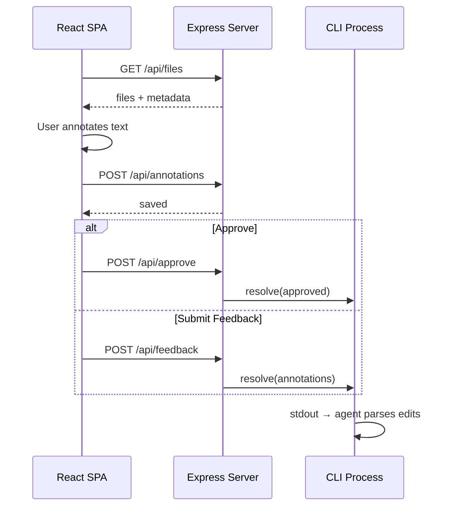

# API Documentation

REST API reference for md-annotator server.

Back to [Main Document](../main.md) | See also [User Guide](./guide.md)

## Request Flow



## Endpoints

### GET /api/files

Returns all loaded files with content and metadata.

```json
{
  "success": true,
  "data": {
    "files": [
      { "index": 0, "path": "main.md", "content": "...", "contentHash": "abc123" }
    ],
    "origin": "claude-code"
  }
}
```

### POST /api/file/open

Opens a linked file by relative path.

**JSON body:**
- `path` (required) - Relative path to the markdown file
- `relativeTo` (optional) - Path of the referring file

**Security:** Rejects paths outside `process.cwd()`.

```
POST /api/file/open
{ "path": "./guide.md", "relativeTo": "docs/api.md" }
```

### POST /api/feedback

Submit annotations for all files.

```json
{
  "files": [
    {
      "path": "main.md",
      "annotations": [],
      "blocks": []
    }
  ]
}
```

## Error Responses

All errors follow this format:

```json
{
  "success": false,
  "error": "Human-readable error message"
}
```

Common error codes:
- `400` - Bad request (missing parameters, invalid file type)
- `403` - Access denied (path traversal attempt)
- `404` - File not found
- `500` - Internal server error
